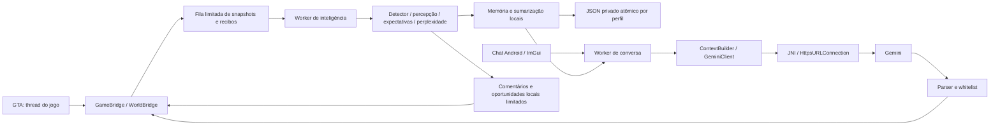

# Arquitetura NPC AI 2.0.0

A base 1.4 permanece responsável por interface, identidade de sessão, controle de tarefas e animações. A migração substitui o transporte obrigatório Python e acrescenta inteligência/persistência em módulos portáveis.

## Responsabilidades e nomes

| Componente | Implementação |
|---|---|
| GameBridge | `game_bridge.cpp`, registro de peds e validação geracional |
| WorldObserver | `world_bridge.cpp`, amostra da engine e hooks SDK |
| WorldEventDetector | `world_core.cpp`, comparação de snapshots e proveniência |
| NpcPerception | Mesmo módulo, distância, visibilidade fornecida pelo adapter, canal e confiança |
| ExpectationManager/Matcher | Mesmo módulo, whitelist de eventos, filtros, prazo e contagem distinta |
| NpcActionController/NpcAnimationController | Controlador existente, estados persistentes e backend `engine_actions.cpp` |
| NpcPersonality | `personality.h`, geração estável por identidade; características nunca vêm de números editados pelo modelo |
| NpcPerplexitySystem | `world_core.cpp`, matemática determinística, habituação, dedup e decaimento |
| NpcMemoryManager | `memory_store.cpp`, perfis, esquema, integridade, limites, backup e gravação atômica |
| LocalContextSummarizer | `EventSummary`, notas tipadas e padrões simples em `intelligence_runtime.cpp`; sem API |
| ContextBuilder | `IntelligenceRuntime::Context`, seleção de notas/eventos/histórico sob orçamento |
| GeminiClient | `gemini_client.cpp`, prompt, schema, Mock, validação, retry e métricas |
| ConfigurationManager | `settings.cpp` e `NativeServices.configure` para credenciais privadas |
| AndroidServices | JNI C++, classes Java no DEX embutido, HTTPS e lifecycle de pausa |

## Threads

A thread do jogo lê os campos do SDK, prepara snapshots pequenos e executa tarefas físicas. Um snapshot não contém ponteiros de entidades. O registro valida o ator controlado por tick; a população completa é atualizada periodicamente (500 ms por padrão). Consultas LOS e tamanhos de amostra têm limites.

A worker de inteligência compara dados, filtra percepção individual, avalia expectativas, atualiza emoções, cria resumos e salva arquivos. Recibos físicos saem da thread do jogo por fila; a serialização de memória não é feita no callback da engine. A fila de frames mantém o mais recente e registra descarte. Controles de load/save têm prioridade e epochs.

A worker de conversa monta JSON e chama JNI. Java usa jobs de rede limitados, sem Activity nova ou Dialog. O lado C++ consulta o resultado em intervalos, responde a cancelamento e nunca executa SDK nessa worker. As threads de UI continuam responsáveis pelo editor anterior. Callbacks Android de pausa/destruição apenas solicitam flush; não escrevem arquivo na UI thread.

Há limites de concorrência também no Java: dois jobs de HTTPS no máximo, cancelamento/desconexão de melhor esforço e deadlines finitos. Jobs não fazem callback de engine nem dependem de interpretador Python.

## Observação e proveniência

Cada evento tem tipo, ID de sessão, posição, horário, intensidade, confiança, origem e indicação de canal. A confiança não significa autoria. O adapter consulta APIs/fields do SDK Android; não usa offsets PC novos.

Diferença de pool significa presença nova/desaparecida na amostra. Um construtor observado é indício adicional de ciclo de vida, mas não prova que CJ criou alguém. Streaming/entrada no raio continuam alternativas explícitas. Desaparecimento não é morte: saúde zero é uma evidência separada.

LOS usa as funções SDK de linha de visão e FOV corporal aproximado; um hit no próprio veículo alvo pode ser aceito como visibilidade do alvo, sem alterar flags globais de colisão. Há fallback conservador quando falta API ou orçamento de LOS. Inferência ambiental em exterior não se transforma em afirmação de visão direta. Dentro de interior esses eventos ambientais são rejeitados para o NPC.

Saltos no relógio são alterações do mostrador entre snapshots. A passagem normal de meia-noite não conta como regressão; grandes voltas ambíguas são tratadas conservadoramente como salto, sem confirmar tempo regressivo. Não se infere autoria pelo jogador. Carregamento de save reinicia o detector para não interpretar um load como teletransporte/mudança sobrenatural.

## Expectativas

O modelo pode enviar zero a três especificações com seis campos. Não há interpretação de expressões, scripts, nomes de métodos ou offsets. Apenas sete eventos monitoráveis entram no matcher. Estado atual, capacidade disponível, confiança, raio, visibilidade, prazo e conjunto de evidências distintas são validados localmente.

Uma correspondência registra: evento detectado, relação temporal com desafio, confiança e causa não confirmada. Um desafio satisfeito não autoriza dinheiro, comando extra ou escrita arbitrária. Expectativas são descartadas em fronteiras de sessão/contexto incompatíveis; nenhuma é reativada para pedestre novo apenas por ter o mesmo modelo.

## Emoções e aprendizagem local

Perplexidade usa intensidade/confiança e personalidade, com ganho pequeno e configurável. Eventos repetidos têm peso decrescente; duplicações recentes não contam. A habituação se recupera mais lentamente que o decaimento emocional. Os valores são limitados a 0..100. Confiança não aumenta automaticamente por fenômeno estranho; medo/agressividade podem reduzi-la. Efeitos físicos confirmados também alteram localmente medo/confiança de maneira limitada.

A aprendizagem é narrativa e determinística. Há notas de experiências e padrões simples de repetição de horário/equipamento; não há treinamento de pesos, aprendizagem geral de estratégias ou consciência literal. Gemini recebe um resumo do estado e decide sua fala/proposta dentro da whitelist.

## Memória e identidade

A estrutura separa notas globais e notas individuais. Memória global tem rótulo narrativo e não é declarada como percepção pessoal de todo NPC. O histórico usado pela API é curto, natural e isolado por ator/conversa; metadados de ação nunca são mensagens de NPC.

Arquivos por perfil ficam em no_backup/npcai. A escrita usa versão, checksum, temporário, fsync, rename e backup. Há tombstone de limpeza para impedir ressurreição acidental pelo backup durante remoção interrompida. Versão de esquema mais nova não é sobrescrita automaticamente. O limite agregado cobre arquivos de memória de múltiplos perfis; podem ser removidos registros/arquivos antigos para respeitar o orçamento.

Hooks de save confirmam slots quando disponíveis. Perfil manual é fallback explícito; ausência de confirmação automática isola uma sessão sem inventar identidade de save. Epochs impedem usar respostas e recibos velhos como contexto da partida seguinte. Não são persistidos ponteiros, handles de tarefas ou instruções para recriar ações físicas.

**Não há identificador individual estável de personagem do GTA ligado ao GameBridge nesta entrega.** Pedestres aleatórios não recuperam memória individual entre sessões. O mecanismo de binding verificado existe e é testado no host, mas sua aplicação a um personagem real exige uma origem estável auditada. A continuidade entregue entre sessões é global/narrativa por perfil; notas individuais antigas ficam arquivadas, sem reatribuição.

## Custos e privacidade

Economy usa somente computação local para observação, emoção, resumo e comentário. Balanced/immersive só autorizam oportunidades de API quando a flag explícita está habilitada e há cooldown/orçamento. O modo imersivo admite eventos menos intensos, sem remover limites. O custo de uma oportunidade recusada pelo chat ocupado não vira uma chamada automática ilimitada.

O orçamento de contexto é aproximado em bytes por token; não se promete tokenização exata do provedor. O histórico e as listas são reduzidos antes de enviar; a mensagem atual e o prompt/schema fixos têm overhead próprio. Uso real informado pelo provedor é contado em métricas. Memória persistente só entra no payload se a opção de envio estiver habilitada.

Os limites e pendências práticas estão em [RELEASE_2_0_0.md](RELEASE_2_0_0.md). A validação distingue host/JVM, compilação e aparelho.
