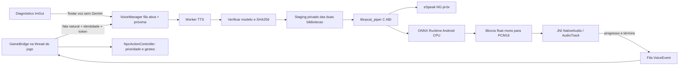

# Arquitetura TTS 2.1.0

`VoiceManager` não inclui headers da engine, não armazena CPed* e não chama SDK. `VoiceBackend`/`VoiceAudio` são interfaces injetáveis para testes. GameBridge valida novamente a identidade/conversa e elegibilidade antes de enfileirar e de aplicar eventos. Os eventos são limitados; fila não cresce com mensagens atrasadas. Testes de voz usam frase local fixa e não entram no histórico Gemini.

Um watchdog de prazo fica ocioso entre trabalhos e apenas sinaliza cancelamento; não faz síntese. Backend cancelável usa Ort::RunOptions.SetTerminate. A thread de síntese é a única que cria/libera sessão, chama eSpeak, processa chunks e escreve/limpa o AudioTrack. `Cancel()` do controle não aguarda o mutex de carga do modelo: usa try_lock para não parar a thread do jogo. Interrupção da construção da sessão é de melhor esforço, com descarte posterior do resultado.

A sessão é carregada preguiçosamente uma vez por processo/configuração e reutilizada. Bibliotecas são carregadas por caminho absoluto em escopo local, com C ABI e API ORT fornecida explicitamente; nenhum objeto STL atravessa a fronteira. O mapa de exports do adaptador esconde seus símbolos internos e os símbolos estáticos eSpeak/C++.

`StageVoiceLibraries` testa fonte/hash, cópia atômica, cache idêntico e rejeição de fonte inválida. Foi implementado após auditar `AndroidModLoader/AndroidModLoader` commit `cea56d084e59a5e957f78ec012edb5e397abdcb6`, `main.cpp::LoadMods` e `src/aml.cpp`. A cópia privada imita o mecanismo real de origem/cópia/dlopen do loader, mas precisa de validação sob o SELinux/namespace do APK real.

As ações físicas e suas prioridades permanecem no controlador anterior. `VoicePlayback` só mantém a janela de gestos enquanto há reprodução válida; não submete tarefas a partir da worker. Rendição/seguimento/fuga, missão e combate podem impedir gestos. Erro antes de iniciar áudio devolve a fala natural ao agendamento textual de gestos; não injeta um erro no diálogo.

Os dados e cache de áudio são locais. Síntese, hash, cópia de bibliotecas e gravação de instalação acontecem na worker, fora do loop de jogo. Não existe rede no backend TTS nem um serviço HTTP para voz. `tools/download_voice.py`, Python, CMake e o teste ONNX Linux são ferramentas de desenvolvimento/instalação, não componentes em execução no Android.
